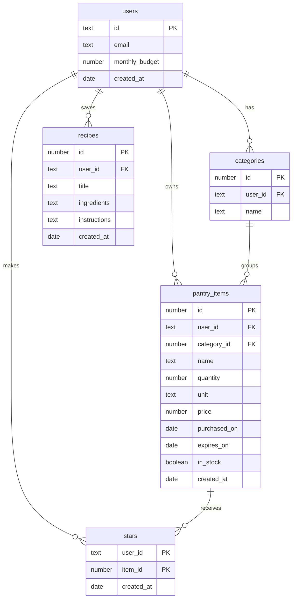

# Pantry: Project Plan

## 1. Pitch

I'm building **Pantry** because I buy groceries without knowing what's already at home, end up
with ingredients I only use once, and lose track of what I spend. Pantry keeps an inventory of
everything in my kitchen, uses Claude to suggest recipes from what I already have, builds a
shopping list of versatile ingredients, and tracks my grocery budget.

**How often I'll use it:** several times a week. I update it after every grocery run and open it
whenever I'm deciding what to cook or what to buy.

## 2. Features

Numbered in the order I'll build them. Features 1-7 are the required spine; 8-10 are mine.

1. **Sign up and login.** As a home cook, I want to create my own account and log in and out, so
   that my pantry and spending stay private to me.
2. **Data model.** As a home cook, I want my pantry items grouped into categories (produce,
   grains, dairy, spices), so that I can see what I have at a glance.
3. **Create, read, update, delete.** As a home cook, I want to add an item with its name,
   category, quantity, unit, price, purchase date and expiry date, see my list, open one item's
   page, edit it, and delete it after an "Are you sure?" check, so that the app matches my kitchen.
4. **Validation.** As a home cook, I want a friendly message when I leave the name, category or
   quantity blank, or enter a negative price, so that my inventory stays accurate.
5. **Stars.** As a home cook, I want to star my staples (the items I always want at home) and see
   them in a Staples view, so that I know what to restock.
6. **Find things.** As a home cook, I want to search by name, filter by category and by in stock
   or out of stock, and sort by expiry date, newest or price, so that I can find any item in seconds.
7. **Dashboard.** As a home cook, I want to see how much I've spent this month, how many items I
   have in stock and how many expire in the next 7 days, plus a chart of spending by category, so
   that I can see where my grocery money goes.
8. **What can I cook?** As a home cook, I want Claude to suggest 3-5 recipes that use mostly what's
   in stock, favoring items that expire soon, and to save the ones I like, so that I cook with what
   I have instead of buying more.
9. **Smart shopping list.** As a home cook, I want Claude to build a short shopping list of my
   out-of-stock staples plus a few versatile ingredients that unlock the most new recipes, within my
   remaining budget, so that I only buy what's necessary.
10. **Budget tracker.** As a home cook, I want to set a monthly grocery budget and see spent versus
    budget, with a warning when I'm close to the limit, so that I stay on track.

## 3. Database

| Table | Columns (type) | Primary key |
| --- | --- | --- |
| users | id (text), email (text), monthly_budget (number), created_at (date) | id (same as the Supabase login id) |
| categories | id (number), user_id (text), name (text) | id |
| pantry_items | id (number), user_id (text), category_id (number), name (text), quantity (number), unit (text), price (number), purchased_on (date), expires_on (date), in_stock (true/false), created_at (date) | id |
| recipes | id (number), user_id (text), title (text), ingredients (text), instructions (text), created_at (date) | id |
| stars | user_id (text), item_id (number), created_at (date) | the pair (user_id, item_id) |

**How the tables connect**

- One user has many categories, pantry items and saved recipes (one-to-many).
- One category has many pantry items (one-to-many).
- Users and pantry items are connected many-to-many through `stars`: each row means "this user
  marked this item as a staple." One table for everyone.
- Every table has row-level security, so a user can only read and change their own rows.

## 4. Tests

1. **Data isolation.** Given User A has a pantry item and User B has none, when User B loads their
   pantry or asks for User A's item by its id, then User B gets an empty list and no item back.
2. **Dashboard.** Given three items bought this month for $4, $6 and $10, and one bought last month
   for $5, when the dashboard calculates spending this month, then it shows $20.

## 5. Technologies

| What | Choice | Why |
| --- | --- | --- |
| Coding agent | Claude Code | It runs git and GitHub commands itself, so each issue, branch and PR is one prompt. |
| Framework | Next.js with Tailwind | Pages and server code live in one project, and Tailwind makes a consistent look quick. |
| Database | Supabase (Postgres) | A real relational database with row-level security, which enforces data isolation in the database itself. |
| Sign up and login | Supabase Auth, email and password | Built into the same service as the database, so each login maps directly to a row in `users`. |
| Hosting | Vercel | Redeploys automatically on every merge to main, so the live URL is always current. |
| AI | Claude API (claude-sonnet-5-5) | Suggests recipes from my inventory and builds the shopping list. |
| Chart | Recharts | A simple React chart library for the spending chart. |
| Tests | Vitest | Fast, simple tests that run with one command. |

## 6. Design

Clean but warm: friendly rather than corporate.

- **Colors:** purple and white. Primary purple `#6B4EFF` for buttons and highlights, deep purple
  `#3D2A8C` for headings, light lavender `#F4F1FF` for backgrounds and cards, white for the main
  surface, amber `#F5A524` for items expiring soon and soft red `#E5484D` for over budget.
- **Style:** rounded corners, generous white space, one clear action per screen, a rounded
  friendly font (Nunito), and short, upbeat copy.
- **Inspiration:** Paprika for its tidy recipe and pantry lists, and Mealime for its friendly,
  low-effort cooking flow.

## 7. Risks and cuts

- **Least sure I can build:** the smart shopping list. Judging which ingredients are "versatile"
  depends on Claude's suggestions, and prices are only as good as what I enter.
- **Cut first if I run out of time:** the "versatile ingredients" part of the shopping list. It
  becomes a plain restock list of out-of-stock staples, still within budget.
- **Cut second:** saving recipes. Suggestions would show on screen without being stored.

## 8. Plan vs. Reality

### How this plan started

I first started with an app for Focus - which proved to be very difficult to build (I needed external applications and most of it would run outside the web app) - so I scrapped it.

### Feature by feature

| Planned feature | Shipped / Changed / Cut | Status (Done/Backlogged) | Learning | What changed and why (one line) |
| --- | --- | --- | --- | --- |
| 1. Sign up and login | Changed | Done | Having login built in the app is very slow, specially when logging in multiple times (for each test environment) - using APIs is more comfortable, but may cost money for bigger apps | Added "Continue with Google" and "Continue with GitHub" (PR #32) on top of email/password |
| 2. Data model | Shipped | Done | | Built as planned (PR #6 |
| 3. Create, read, update, delete | Shipped | Done | | Built as planned (PR #8). |
| 4. Validation | Shipped | Done | Checks belong in the database too, not only in the form. | Friendly messages in the form plus database checks on quantity and price (PR #10). |
| 5. Stars (staples) | Shipped | Done | | Built as planned (PR #12). |
| 6. Find things | Shipped | Done | Not every QoL is worth it: I tried at first to make the page not reload as a whole, just the specific field and it broke the app in every try. I dropped it. | An agent "no reload" upgrade duplicated the search bar on every "Clear all"; I caught it and had it reverted (PR #14). |
| 7. Dashboard | Changed | Done | Just because you have data does not mean you have to show it: the app had spending by category and it was absolutely useless without more data | Added period filters and spending over time to the Dashboard. Had to fix the X axis, which was broken (PR #16). |
| 8. What can I cook? | Shipped | Done | Testing on localhost can make you think everything is working when it is not: Vercel authorizations were wrong and the app shipped broken, had to be fixed. | Changed API authorizations in order to make sure it worked. Feature shipped as intended. |
| 9. Smart shopping list | Shipped | Done | | |
| 10. Budget tracker | Shipped | Done | | Built as planned (PR #22); |
| Test: data isolation | Shipped | Done | | PR #24, with red/green screenshots. |
| Test: dashboard stat | Shipped | Done | | PR #26, with red/green screenshots. |
| Design: purple and white, Nunito | Changed | Done | Claude is really good at design but needs minimal references - the app was very ugly and barebones with just colour and font, but as soon as I added some references it became really good | First pass felt childish (PR #28); refined to an editorial serif (Newsreader) with Inter, thinner borders and a login inside the main layout (PR #31). |
| Quick quantity updates and "I cooked this" (not planned) | Added | Done | Having all the functions I need is not enough - it has to be convenient - I cooked some fried rice to test and taking the ingredients off the list was unbearable | Fix (PR #34): −/+, "Used half", "Used all" and Undo on each item, a log of every use and purchase, and a minimal "I cooked this" on saved recipes. |
| Spreadsheet import (not planned) | Added | Done | Adding items one by one is the slowest part of a pantry app. | From stranger-test feedback: import .csv or .xlsx with a preview that flags bad rows; existing items get topped up instead of duplicated (PR #36). |
| Receipt or online-order photo (not planned) | Cut | Backlogged | Novel features can be way more difficult to build than what I first thought. Data writing through multiple steps might be dangerous to my database. | From stranger-test feedback; scoped but not built: matching receipt abbreviations to my items needs a review screen, or wrong matches could quietly corrupt quantities and spending. |
| Purchases counted as spending (implied by features 7 and 10) | Changed | Backlogged | Two ways of recording the same fact (item price vs. purchase log) drift apart. | "+" and spreadsheet top-ups update quantity but not spending, because spending still comes from each item's single price and purchase date (see the rewritten Database section in my reflection). |
| Unit conversion, e.g. 200 g + 10 kg of rice (not planned) | Cut | Backlogged | | Quantities only add up when the units match; conversion between g and kg, ml and L was not built. |
| Suggested staples and ingredient-usage chart (not planned) | Cut | Backlogged | Useful things can be built afterwards if they need weeks of data - I can just backlog it and track the variables | The purchase and use log now exists, so this can be built on it later. |
| "Cook with these" picker for recipe ideas (not planned) | Cut | Backlogged | | Choosing must-use ingredients before asking for recipes; left for after Demo Day. |
| Recipe catalog file (not planned) | Cut | Backlogged | No need to store what I can bring from an API | A 50-recipe reference file was prepared to make recipe matching cheaper and more reliable, but recipes still come only from Claude. |
