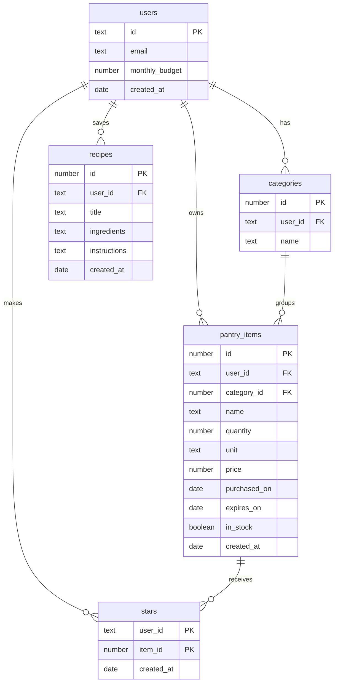

# Pantry: Project Plan

## 1. Pitch

I'm building **Pantry** because I buy groceries without knowing what's already at home, end up
with ingredients I only use once, and lose track of what I spend. Pantry keeps an inventory of
everything in my kitchen, uses Claude to suggest recipes from what I already have, builds a
shopping list of versatile ingredients, and tracks my grocery budget.

**How often I'll use it:** several times a week. I update it after every grocery run and open it
whenever I'm deciding what to cook or what to buy.

## 2. Features

Numbered in the order I'll build them. Features 1-7 are the required spine; 8-10 are mine.

1. **Sign up and login.** As a home cook, I want to create my own account and log in and out, so
   that my pantry and spending stay private to me.
2. **Data model.** As a home cook, I want my pantry items grouped into categories (produce,
   grains, dairy, spices), so that I can see what I have at a glance.
3. **Create, read, update, delete.** As a home cook, I want to add an item with its name,
   category, quantity, unit, price, purchase date and expiry date, see my list, open one item's
   page, edit it, and delete it after an "Are you sure?" check, so that the app matches my kitchen.
4. **Validation.** As a home cook, I want a friendly message when I leave the name, category or
   quantity blank, or enter a negative price, so that my inventory stays accurate.
5. **Stars.** As a home cook, I want to star my staples (the items I always want at home) and see
   them in a Staples view, so that I know what to restock.
6. **Find things.** As a home cook, I want to search by name, filter by category and by in stock
   or out of stock, and sort by expiry date, newest or price, so that I can find any item in seconds.
7. **Dashboard.** As a home cook, I want to see how much I've spent this month, how many items I
   have in stock and how many expire in the next 7 days, plus a chart of spending by category, so
   that I can see where my grocery money goes.
8. **What can I cook?** As a home cook, I want Claude to suggest 3-5 recipes that use mostly what's
   in stock, favoring items that expire soon, and to save the ones I like, so that I cook with what
   I have instead of buying more.
9. **Smart shopping list.** As a home cook, I want Claude to build a short shopping list of my
   out-of-stock staples plus a few versatile ingredients that unlock the most new recipes, within my
   remaining budget, so that I only buy what's necessary.
10. **Budget tracker.** As a home cook, I want to set a monthly grocery budget and see spent versus
    budget, with a warning when I'm close to the limit, so that I stay on track.

## 3. Database

| Table | Columns (type) | Primary key |
| --- | --- | --- |
| users | id (text), email (text), monthly_budget (number), created_at (date) | id (same as the Supabase login id) |
| categories | id (number), user_id (text), name (text) | id |
| pantry_items | id (number), user_id (text), category_id (number), name (text), quantity (number), unit (text), price (number), purchased_on (date), expires_on (date), in_stock (true/false), created_at (date) | id |
| recipes | id (number), user_id (text), title (text), ingredients (text), instructions (text), created_at (date) | id |
| stars | user_id (text), item_id (number), created_at (date) | the pair (user_id, item_id) |

**How the tables connect**

- One user has many categories, pantry items and saved recipes (one-to-many).
- One category has many pantry items (one-to-many).
- Users and pantry items are connected many-to-many through `stars`: each row means "this user
  marked this item as a staple." One table for everyone.
- Every table has row-level security, so a user can only read and change their own rows.

## 4. Tests

1. **Data isolation.** Given User A has a pantry item and User B has none, when User B loads their
   pantry or asks for User A's item by its id, then User B gets an empty list and no item back.
2. **Dashboard.** Given three items bought this month for $4, $6 and $10, and one bought last month
   for $5, when the dashboard calculates spending this month, then it shows $20.

## 5. Technologies

| What | Choice | Why |
| --- | --- | --- |
| Coding agent | Claude Code | It runs git and GitHub commands itself, so each issue, branch and PR is one prompt. |
| Framework | Next.js with Tailwind | Pages and server code live in one project, and Tailwind makes a consistent look quick. |
| Database | Supabase (Postgres) | A real relational database with row-level security, which enforces data isolation in the database itself. |
| Sign up and login | Supabase Auth, email and password | Built into the same service as the database, so each login maps directly to a row in `users`. |
| Hosting | Vercel | Redeploys automatically on every merge to main, so the live URL is always current. |
| AI | Claude API (claude-sonnet-5-5) | Suggests recipes from my inventory and builds the shopping list. |
| Chart | Recharts | A simple React chart library for the spending chart. |
| Tests | Vitest | Fast, simple tests that run with one command. |

## 6. Design

Clean but warm: friendly rather than corporate.

- **Colors:** purple and white. Primary purple `#6B4EFF` for buttons and highlights, deep purple
  `#3D2A8C` for headings, light lavender `#F4F1FF` for backgrounds and cards, white for the main
  surface, amber `#F5A524` for items expiring soon and soft red `#E5484D` for over budget.
- **Style:** rounded corners, generous white space, one clear action per screen, a rounded
  friendly font (Nunito), and short, upbeat copy.
- **Inspiration:** Paprika for its tidy recipe and pantry lists, and Mealime for its friendly,
  low-effort cooking flow.

## 7. Risks and cuts

- **Least sure I can build:** the smart shopping list. Judging which ingredients are "versatile"
  depends on Claude's suggestions, and prices are only as good as what I enter.
- **Cut first if I run out of time:** the "versatile ingredients" part of the shopping list. It
  becomes a plain restock list of out-of-stock staples, still within budget.
- **Cut second:** saving recipes. Suggestions would show on screen without being stored.
