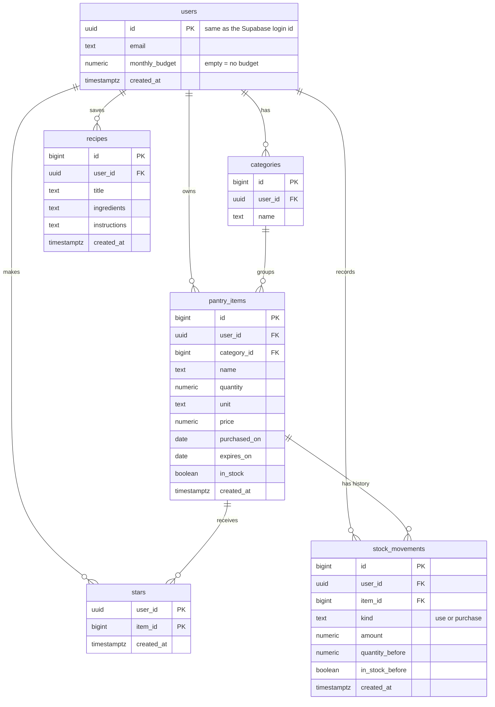

# Pantry: database schema

The database is Supabase Postgres. Everything here was created by the five SQL files in
[`supabase/migrations/`](supabase/migrations), run in order. This file describes what is **actually
built**, then compares it with [section 3 of PLAN.md](PLAN.md#3-database).

## Tables at a glance

| Table | One row is… | Belongs to |
| --- | --- | --- |
| `users` | one account | Supabase Auth (`auth.users`) |
| `categories` | a shelf, like "Dairy" or "Produce" | a user |
| `pantry_items` | one thing in my kitchen, with its current quantity | a user and a category |
| `stars` | "this user marked this item as a staple" (junction table) | a user and an item |
| `recipes` | a recipe I saved from Claude's suggestions | a user |
| `stock_movements` | one "use" or "purchase" of an item, for history and Undo | a user and an item |

## How the tables relate

- **One user has many** categories, pantry items, stars, saved recipes and stock movements.
- **One category has many** pantry items. Every item sits in exactly one category.
- **Users and pantry items are connected many-to-many through `stars`.** Each row pairs a user with
  an item they starred. The pair is the primary key, so an item can't be starred twice.
- **One pantry item has many** stock movements (its history of uses and purchases).
- **Deleting cascades:** delete an account and all its rows go; delete a category and its items go;
  delete an item and its stars and movements go.

## Every table and column

`user_id` columns default to the signed-in user (`auth.uid()`), so the app never has to send them.
Ids marked *auto* are generated by the database.

### `users`
| Column | Type | Rules |
| --- | --- | --- |
| `id` | uuid | Primary key. Same id as the Supabase Auth login; deleted with it. |
| `email` | text | Required. |
| `monthly_budget` | numeric(10,2) | Optional (empty = no budget). Must be more than 0. |
| `created_at` | timestamptz | Defaults to now. |

A trigger (`on_auth_user_created`) adds the row automatically when someone signs up, by email,
Google or GitHub.

### `categories`
| Column | Type | Rules |
| --- | --- | --- |
| `id` | bigint | Primary key, *auto*. |
| `user_id` | uuid | Required. References `users`. |
| `name` | text | Required, can't be blank. |

### `pantry_items`
| Column | Type | Rules |
| --- | --- | --- |
| `id` | bigint | Primary key, *auto*. |
| `user_id` | uuid | Required. References `users`. |
| `category_id` | bigint | Required. References `categories`, and must be one of the user's own categories. |
| `name` | text | Required, can't be blank. |
| `quantity` | numeric | Required, can't be negative. |
| `unit` | text | Optional (empty = whole items). |
| `price` | numeric(10,2) | Optional, can't be negative. |
| `purchased_on` | date | Optional. |
| `expires_on` | date | Optional. |
| `in_stock` | boolean | Defaults to true. |
| `created_at` | timestamptz | Defaults to now. |

### `stars` (junction table)
| Column | Type | Rules |
| --- | --- | --- |
| `user_id` | uuid | Part of the primary key. References `users`. |
| `item_id` | bigint | Part of the primary key. References `pantry_items`, and must be the user's own item. |
| `created_at` | timestamptz | Defaults to now. |

### `recipes`
| Column | Type | Rules |
| --- | --- | --- |
| `id` | bigint | Primary key, *auto*. |
| `user_id` | uuid | Required. References `users`. |
| `title` | text | Required. |
| `ingredients` | text | One ingredient per line; missing ones end with "(need to buy)". |
| `instructions` | text | One numbered step per line. |
| `created_at` | timestamptz | Defaults to now. |

### `stock_movements`
| Column | Type | Rules |
| --- | --- | --- |
| `id` | bigint | Primary key, *auto*. |
| `user_id` | uuid | Required. References `users`. |
| `item_id` | bigint | Required. References `pantry_items`, and must be the user's own item. |
| `kind` | text | `use` or `purchase`. |
| `amount` | numeric | More than 0, in the item's unit. |
| `quantity_before` | numeric | The item's quantity before this change (used by Undo). |
| `in_stock_before` | boolean | The item's in-stock flag before this change (used by Undo). |
| `created_at` | timestamptz | Defaults to now. |

Two database functions are the only way the app writes movements:
- `record_movement(item_id, kind, amount)` logs a use or purchase and updates the item's quantity and
  in-stock flag in one transaction. Using never goes below 0, and 0 means out of stock; buying marks it
  in stock.
- `undo_movement(movement_id)` puts the item back exactly as it was and deletes that movement.

Both run as the signed-in user, so the security rules below still apply.

## Security: each user sees only their own data

Row-level security is on for **every** table:

- `categories`, `pantry_items`, `recipes`: read, add, change and delete only rows whose `user_id` is
  yours.
- `stars`: read, add and delete your own (there's nothing to change in a star).
- `stock_movements`: read, add and delete your own.
- `users`: read your own row, and change **only** its `monthly_budget` column.
- **Extra checks:** an item can only go in one of your own categories, and a star or movement can only
  point at one of your own items.

The data isolation test (`tests/data-isolation.test.ts`) proves this: a second user signed in with
the public key gets an empty list and no row when asking for the first user's item.

## Did the agent build what I designed?

**Mostly yes.** All five tables from section 3 of the plan exist with every planned column and the
planned relationships. The differences:

| Area | Plan (section 3) | Built | Whose call |
| --- | --- | --- | --- |
| User ids | `id (text)`, `user_id (text)` | `uuid` everywhere | Agent proposed it to match Supabase Auth's ids; I approved the data-model plan. |
| Dates and times | `created_at (date)` | `timestamptz` (date and time) | Agent. |
| Numbers | `number` | `numeric`; money as `numeric(10,2)` | Agent. |
| Required fields | Not specified | name, category and quantity required on items, title on recipes, names can't be blank | Agent proposed; matches feature 4 (validation). |
| Value checks | Not specified | No negative quantity or price; budget must be positive | Agent, as the database backup for feature 4, and feature 10. |
| Deletes | Not specified | `on delete cascade` on every link | My prompt asked for it. |
| Security | "users only touch their own rows" | Plus the ownership checks on categories, stars and movements, and budget-only updates on `users` | Agent. |
| Creating `users` rows | Not specified | Trigger on sign-up | My feature 1 prompt asked for it. |
| `stock_movements` | **Not in the plan** | Added in PR #34 | My choice when the agent asked (the plan had no history of uses and purchases). |

**What the plan got wrong, and the built schema still has:** spending lives on each item as a single
`price` and `purchased_on`. When an item is bought again (with "+" or a spreadsheet top-up), the
purchase is logged in `stock_movements` without a price, so the dashboard, budget bar and shopping
list don't count it. See "Purchases counted as spending" in
[PLAN.md's Plan vs. Reality](PLAN.md#8-plan-vs-reality).

**Not enforced by the database:** item and category names aren't unique per user. The import
matches names without caring about capitals so it doesn't create duplicates, but the "Add item" form
can still create two items with the same name.
